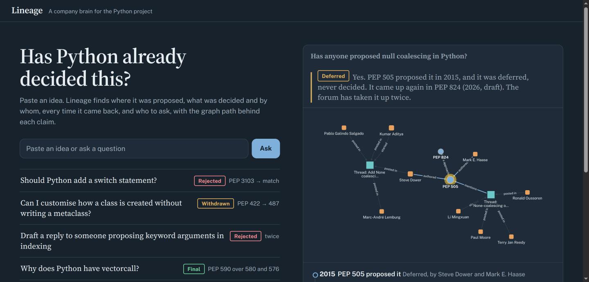
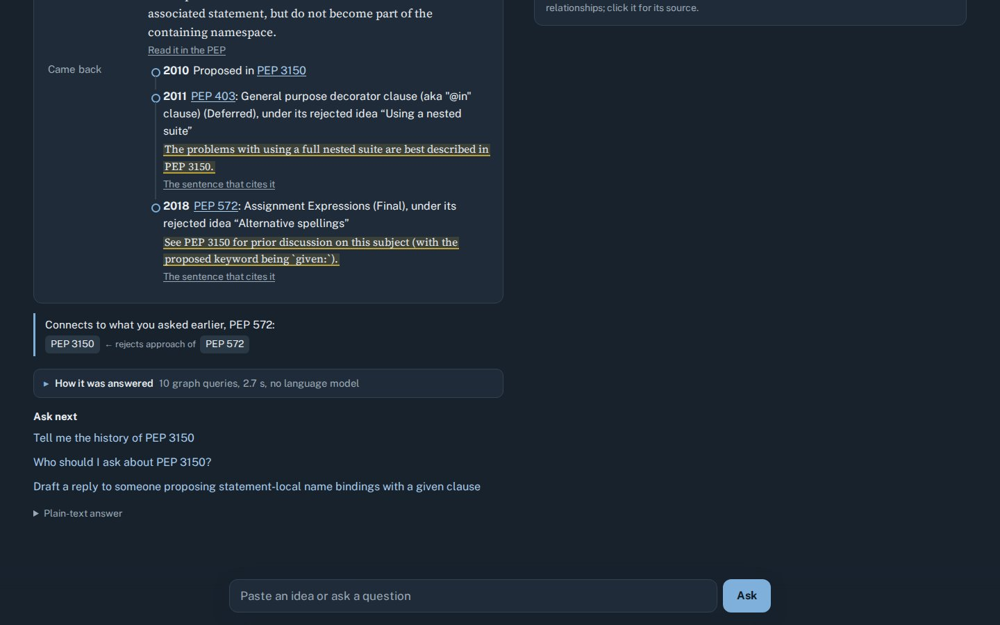

# Lineage: a company brain for the Python project

**Has Python already decided this?** Paste an idea and Lineage answers from a FalkorDB graph of 25 years of
Python's decisions: the PEP that proposed it, the ruling and who made it, whether the idea came back later,
the sentence from the source that says so, and who to ask. It can draft the reply. Every answer comes with
the graph path that produced it and the exact Cypher that ran.

Built for **Graph Hacks: Context for AI Agents** (WeMakeDevs × FalkorDB), **Track 03: Company Brain**. The
company is the Python project: one of the largest open-source organisations, with its decisions in public PEPs,
forum threads and Steering Council issues.

> **Live demo:** [anmolgupta-24.github.io/lineage-agent](https://anmolgupta-24.github.io/lineage-agent/demo/) (67 answers recorded from the graph; run it locally to ask anything) ·
> **Demo video:** [watch (2:51, narrated, captioned)](https://cdn.jsdelivr.net/gh/ANMOLGUPTA-24/lineage-agent@7a4cbb155b35fda916942f1a202876e7de0f51ba/docs/video/lineage-demo.mp4) ·
> **Run it locally:** `docker compose -f docker-compose.quick.yml up --build` → http://localhost:8000 (pre-built graph, no API key;
> 2–4 minutes the first time, about 1 GB of images; port taken? set `ports: ["8080:8000"]` in the compose file) ·
> [](https://codespaces.new/ANMOLGUPTA-24/lineage-agent?quickstart=1)



### The problem is real

> "Research whether your idea has been proposed before. There are many suggestions that have been made and
> rejected in the past. … Previously rejected ideas are especially unlikely to get accepted."
> — [CPython Developer's Guide, *Changing Python*](https://devguide.python.org/developer-workflow/lang-changes/)

> "The problem is that people have asked it. Then asked it again. And again. And again. … As a maintainer,
> it's not very fun to keep having to say no over and over in slightly different ways."
> — David Lord, replying on [discuss.python.org](https://discuss.python.org/t/why-not-real-anonymous-functions/44513/14)
> to a proposer who had "searched this forum as well as all of the PEPs" and found nothing

It keeps happening: new lambda or anonymous-function syntax alone was proposed in **8 Ideas topics between 2019
and 2026** (355 posts; titles and counts from the forum's own JSON, in `data/raw/discourse.json`).

Keyword search over PEP titles and forum posts misses rejected ideas buried inside other PEPs (1,085 of them)
and ideas phrased differently. Lineage reads the rejected-ideas sections, links them to what they rejected,
and walks those links: "multi-line lambdas" returns the 2023 and 2025 forum threads and the core developer who answered.

### How it maps to the Company Brain brief

| The brief asks for | In Lineage |
|---|---|
| Knowledge from docs, tickets and chats in one graph | PEPs and their sections (docs), CPython PRs and issues (tickets), discuss.python.org threads (chats) |
| Who owns what, and who knows what | `who_knows`: PageRank over who builds on whom, per area; `bus_factor`: WCC with and without the key person |
| Tracing decisions back to their source | `Decision -[MADE_BY]->` person or council, quoted rulings, `REJECTS_APPROACH_OF` chains across PEPs |
| Keeping knowledge current | `make sync`: rebuild beside the live graph, record `Change` events, swap atomically |
| Answers with clear sources | every claim quoted from the source with a deep link; when an LLM writes the answer, a guard rejects any PEP, name or quote the graph didn't return |
| Gets work done | `draft_reply` writes the forum reply, built only from graph rows |

The graph schema and the tools are source-agnostic. Pointing Lineage at an organisation's RFCs or ADRs
(with their "rejected alternatives" sections), its tracker and its chat means writing one parser per source;
the tools that answer "has this team already decided this?" don't change.

### Does the graph matter? Measured against vector and keyword search on the same data

| 98 questions with known answers (n) | Lineage (graph) | Vector search* | BM25 keyword search* |
|---|---|---|---|
| Did the idea come back later? (3) | **3** | 0 | 0 |
| How are two PEPs related? (4) | **4** | 1 | 2 |
| Who decided it? (6) | **5** | 1 | 1 |
| Has this idea been decided? Right PEP as the top answer, **held-out** set (17) | **13** | 9 | 11 |
| Is it still current? (31 superseded PEPs) | **31** | 29 | 29 |
| Right PEP anywhere in the top 5 (37; Lineage: top answer only) | 29 | **36** | 35 |

\*Same text, same embedding model, each baseline's no-match cutoff tuned on these very questions. The first
three rows are questions a list of text chunks can't represent; the held-out row is the accuracy test, and n is
small. Lineage is wrong on 3 of 32 confident matches; every miss is listed in [eval/RESULTS.md](eval/RESULTS.md).
Details below.

**Scale:** 745 PEPs, 1,085 rejected ideas and 866 quotable sections parsed from the PEP sources, 1,748
discuss.python.org threads, 505 CPython PRs and 460 issues, 257 rulings, 2,175 people, built deterministically
from public data in under 4 minutes (`make ingest`), with a 69-test suite.

**What the graph does per answer:** typed traversals over evidence edges extracted from the PEPs' own text
(`REJECTS_APPROACH_OF`, `CITES`), `algo.SPpaths` with hub-aware weights, PageRank and WCC on per-area
projections, and session memory as graph nodes. Every answer lists the steps that ran, draws the subgraph it
walked, and shows the exact Cypher with its parameters.


| Did the idea come back? | Who should I ask about typing? | Memory in the graph |
|---|---|---|
|  |  |  |

## Why a graph?

The questions people actually ask about a language are about relationships:

- *Why does pattern matching look like this?* PEP 634 → PEP 622 (superseded) → … → earlier proposals it cites.
- *Is PEP 333 still the WSGI spec?* Follow `SUPERSEDES` to PEP 3333.
- *Who should I ask about typing?* Authors, deciders and implementers across 49 typing PEPs, ranked.
- *If one maintainer left packaging, what would be orphaned?*

Embedding search over PEP text can find a PEP, but it can't tell you that a PEP was superseded,
who ruled on it, or which earlier proposals it builds on four hops back. Those are edges.
**Take FalkorDB out and every tool stops working.** Vector search is only used to turn
"walrus operator" into PEP 572.

## What it does

| Tool | Question | Graph work |
|---|---|---|
| `resolve(text)` | "walrus operator" → PEP 572 | exact number → full-text index → vector index; reports when a match is ambiguous |
| `why(pep, depth≤4)` | Why/how did X come about? | variable-length `REQUIRES\|REFERENCES\|SUPERSEDES*1..4`, cheapest path per ancestor, drift filter by `vec.cosineDistance`; ruling + who made it; implementing PRs |
| `is_current(pep)` | Is X still how Python works? | `SUPERSEDES*` chain to the latest PEP |
| `who_knows(subject)` | Who should I ask? | **PageRank** over the area's own influence graph (`INFLUENCE_<area>`: who the area's PEPs and PRs build on), plus the most active people and, for a PEP, its own authors and decider |
| `bus_factor(subject)` | Where is knowledge concentrated? | PEPs that depend on one person, and **WCC** on the area's influence graph with and without its top person |
| `connection(a, b)` | How are A and B related? | **`algo.SPpaths`** weighted shortest paths over every relationship type |
| `already_decided(idea)` | Has Python already decided this? | vector + full-text candidates over PEPs, 1,085 rejected ideas and 1,748 forum threads, scored by a local cross-encoder; then a traversal: ruling, decider, the PEP's own rejection notice (quoted), `SUPERSEDES*`, and earlier or later PEPs whose rejected ideas cite it (`REJECTS_APPROACH_OF*1..3`) |
| `draft_reply(idea)` | Answer a forum proposal | a reply built only from `already_decided` rows: quotes, deep links, who to ask. Nothing is posted |
| *(after every answer)* | "You asked about PEP 572 earlier…" | session memory in the graph: `(:Session)-[:ASKED]->(:Query)-[:ACCESSED]->(:PEP)`; `algo.SPpaths` from this answer's PEP to the nearest PEP asked about earlier; `my_session` answers "what did I ask earlier?". Carried across sync swaps |
| `recall` / `remember` | What did we find last time? | `Finding` nodes linked to the PEP they describe |

The model **never writes Cypher**. It picks a tool and fills typed arguments; each query is
hand-written and parameterized (no string concatenation, so no injection), and runs read-only.

### Four kinds of answer

1. **Answered with a path.** The graph holds the relationships, and the UI draws them.
2. **Answered from memory.** A dated finding from an earlier session.
3. **Not in the graph.** The entity exists but no relationship is recorded. Lineage says
   *"the graph doesn't record one"*, never *"there is none"*.
4. **Unknown entity.** The name doesn't resolve, so no query runs. ("Why does Python have the banana keyword?")

### Honesty guard

After the LLM writes its answer, every `PEP NNN`, person name, verdict word ("accepted", "rejected"…),
year and quotation in it is checked against the tool results. If it states something the graph never
returned, the answer is **rejected** and
replaced with one built directly from the rows. The UI shows the rejected text crossed out.
Decisions the source data doesn't attribute (pre-2018 rulings without a named delegate, for example)
are marked `inferred` and drawn dashed.

## Evaluation, briefly

98 questions with known answers (table at the top). The "has this been decided?" set has a **held-out** part
written after the system was built and never tuned on; currency questions are generated from the raw
`peps.json`, not from the graph. The vector baseline gets the same corpus, the same embedding model and a
no-match cutoff tuned on these questions; with no LLM in the loop it is scored on evidence recall (do its top
5 chunks contain the answer?), an upper bound for any LLM answering from them.

What it says: finding the PEP for an idea is a retrieval problem, and vectors are good at it (the right PEP is
in the baseline's top 5 for 97% of ideas). Every question after that is a relationship, and that is where
retrieval stops. Where Lineage is wrong: 3 of 32 confident "same idea" answers name the wrong PEP, several
right answers come out only "related", and two ground-truth labels were widened after the first run (both to
PEPs that themselves proposed the idea; recorded in `eval/questions.jsonl`). The keyword router's 98/98 tool
choices should be read with care: it was written alongside these questions. On the 60 most recent Ideas topics,
Lineage found an earlier same-idea record for 1 and earlier related history for 11 (18%): most new ideas really
are new, and the value is in the ones that aren't ([eval/RECENT_IDEAS.md](eval/RECENT_IDEAS.md)). Every miss:
[eval/RESULTS.md](eval/RESULTS.md). Reproduce: `uv run python -m eval.run`.

## Keeping it current

`make sync` (add `FETCH=1` to pull peps.json and the PEP sources first) rebuilds the graph **beside**
the live one, diffs the two and writes `(:Change {at, kind, detail})-[:CHANGED]->(:PEP)` for new PEPs,
status changes, new supersessions, new rulings and newly linked PRs. It then flips the
`lineage:active:<tenant>` alias with one `SET`. Agent memory (`Finding`) and earlier change history
are carried over; findings written during the rebuild are copied after the flip. It refuses to swap
a build that lost more than 5% of PEPs, a Redis lock stops two syncs running at once, and
`make rollback` points the alias back. The `changes` tool answers "what changed lately?".

Tested under load: 4 reader threads made 22,468 queries during a 2-minute sync, every one saw a
complete graph (745 PEPs, old or new), with 0 errors. A simulated upstream change (a status change,
a new PEP, a new supersession) came out as exactly those 3 `Change` events.


## Graph model

```
(:Person {name, github, bridge})-[:AUTHORED {role}]->(:PEP {number, title, status, type, created,
                                                           python_version, url, abstract, rank,
                                                           community, embedding})
(:Person)-[:DELEGATE_FOR]->(:PEP)
(:PEP)-[:SUPERSEDES]->(:PEP)          from Superseded-By / Replaces headers
(:PEP)-[:REQUIRES]->(:PEP)            from Requires headers
(:PEP)-[:REFERENCES]->(:PEP)          PEP mentions in the body text
(:PEP)-[:RESOLVED_BY]->(:Decision {outcome, url, at, verdict, verdict_url})
(:Decision)-[:MADE_BY {inferred}]->(:Person | :Council)
(:PEP)-[:TARGETS]->(:Release {version})
(:PEP)-[:IN_TOPIC]->(:Topic {name})
(:PEP)-[:IN_COMMUNITY]->(:Community {name, hub, size})       label propagation
(:PR | :Issue {number, title, url, merged})-[:IMPLEMENTS | :DISCUSSES]->(:PEP)
(:Person)-[:OPENED]->(:PR | :Issue)
(:Finding {text, at, session})-[:ABOUT]->(:PEP)              agent memory
(:PEP)-[:HAS_SECTION]->(:Section {kind, title, text, url})   Motivation / Rationale / ruling notice
(:Alternative {title, text, url})-[:REJECTED_IN]->(:PEP)      each rejected idea, deep-linked
(:Alternative)-[:CITES {quote}]->(:PEP)                       the sentence that names another PEP
(:PEP)-[:REJECTS_APPROACH_OF {via}]->(:PEP)                   cited PEP was an older, never-adopted proposal
(:Person)-[:INFLUENCE_<area>{n}]->(:Person)                   per-area projection (ingest only)
(:Person)-[:EXPERT_IN {rank, share, items}]->(:Topic | :Community)
(:Thread {title, url, created, posts, text})-[:DISCUSSES | :MENTIONS]->(:PEP)   discuss.python.org
(:Person)-[:STARTED | :POSTED_IN {posts}]->(:Thread)          170 PEP authors matched by name
(:Change {at, kind, detail})-[:CHANGED]->(:PEP)               written by `make sync`
(:Session {id})-[:ASKED]->(:Query {text, at})-[:ACCESSED]->(:PEP)   per-session agent memory
```

Every edge has a `weight`. `REFERENCES` edges cost `1 + ln(1 + in-degree of target)`, so shortest
paths don't route through PEPs that everything cites. Steering Council edges cost 3 for the same reason.

**Algorithms used:** `algo.SPpaths` (connection), `algo.pageRank` (PEP rank, and per-area
expertise over each `INFLUENCE_<area>` projection), `algo.WCC` (bus factor: does the area split
without its top person?), `algo.betweenness` (person bridge score), `algo.labelPropagation`
(communities), plus full-text and vector indexes. FalkorDB's PageRank ignores parallel edges
(tested), so each projection has one edge per pair.

**Why a cross-encoder in `already_decided`:** vector distance alone could not separate "same idea"
from "same words" (multi-line lambdas landed 0.21 from conditional expressions, switch statements
0.30 from the switch PEP). Vectors and full-text only gather candidates; a local MiniLM
cross-encoder scores them: true matches scored 6.0-7.9 on hand-checked ideas, unrecorded ones
below 0. Above 5 is "same idea", 1-5 is labelled "related", and below that the answer is
"the graph doesn't record it", never "it's new". **Every query is listed in [docs/QUERIES.md](docs/QUERIES.md)**, generated
from what the tools actually run.

**Multi-tenant:** each tenant is its own FalkorDB graph (`select_graph`), not a filter clause.

## Data (all public)

| Source | What |
|---|---|
| [peps.python.org/api/peps.json](https://peps.python.org/api/peps.json) | 745 PEPs: status, authors, supersedes/requires, resolution links |
| [github.com/python/peps](https://github.com/python/peps) | PEP-Delegate / BDFL-Delegate, sponsors, abstracts, PEP-to-PEP mentions |
| [github.com/python/steering-council](https://github.com/python/steering-council) | Steering Council rulings on PEPs (closed issues and the final comment) |
| [github.com/python/cpython](https://github.com/python/cpython) | PRs and issues whose title names a PEP (backport bots filtered out) |
| [discuss.python.org](https://discuss.python.org/c/ideas/6) | 2,073 Ideas topics; first post and participants for the 1,551 with 5+ posts, plus the 197 PEP discussion threads (public JSON API, rate-limited, cached) |

Raw API responses are cached in `data/raw/*.json`, so building the graph needs no tokens.

## Run it

**Quickest (about a minute, graph pre-built):**

```bash
docker compose -f docker-compose.quick.yml up --build      # → http://localhost:8000
```

`deploy/graph.rdb` is a saved FalkorDB graph (9 MB) written by the same pinned FalkorDB image the
compose file uses, so nothing is ingested on startup. The **Codespaces** button above runs exactly this.

**Build the graph yourself from the cached public data (about 2 minutes on 8 cores):**

```bash
cp .env.example .env              # optional: add a free LLM key
docker compose up --build         # FalkorDB + ingest + app → http://localhost:8000
                                  # FalkorDB Browser → http://localhost:3000
```

Without Docker for the app:

```bash
docker run -d -p 6379:6379 -p 3000:3000 falkordb/falkordb@sha256:b0bdcac2cbaff989e77cb0610439b7a9289e86de033ccbbd4368b66fb680ae7a
uv sync && make ingest && make app
make test                         # 69 behaviour tests against the loaded graph
make sync                         # rebuild beside the live graph and swap (see "Keeping it current")
uv run python -m eval.run         # the evaluation below
```

A single-container image (FalkorDB on localhost + the app, graph baked in) for any Docker host is in
`deploy/` (`sh deploy/bundle.sh`, then build `build/space`).

### LLM (optional, free options)

**With no key** (the default, and what the demo shows), a keyword router picks the tools and the answer
is built from the graph rows. The graph does the reasoning either way.

With a key, an LLM picks the tools instead and writes the answer, and the guard checks every PEP number,
name and quote it uses against the rows. The loop speaks the OpenAI-compatible chat API (a free Gemini key
from aistudio.google.com, Groq, or a local Ollama model; see `.env.example`). It is covered by tests with a
scripted model; it has not been run against a hosted model for this submission.

### MCP: the agent interface

The web page is one client. The same typed tools are an MCP server, so any agent (Claude Desktop, Claude
Code, Cursor) can use Lineage as its memory of Python's decisions: the same parameterized Cypher (read-only
except `remember`, which saves a finding) and the same paths in every result. Tools: `already_decided`,
`draft_reply`, `why`, `is_current`, `who_knows`, `bus_factor`, `connection`, `changes`, `resolve`, `recall`,
`remember`, `my_session`.

```json
{"mcpServers": {"lineage": {"command": "uv", "args": ["run", "python", "-m", "lineage.mcp_server"],
                            "cwd": "/path/to/lineage"}}}
```

## Layout

```
lineage/ingest/peps.py     PEP API + rst parsing → graph
lineage/ingest/github.py   Steering Council + CPython (fetch → cache → load)
lineage/ingest/derive.py   reverse edges, weights, PageRank, CDLP, betweenness, indexes, embeddings
lineage/tools.py           the tool catalogue (all Cypher lives here)
lineage/agent.py           tool-calling loop, router fallback, guard
lineage/mcp_server.py      MCP server
lineage/server.py, web/    FastAPI + single-page UI (Cytoscape.js)
tests/                     outcomes, depth, supersession, tenant isolation, guard
```

## Limitations

- `REFERENCES` comes from text mentions, so "PEP 572 mentions PEP 3150" may mean "rejected the
  approach of", not "builds on". The UI labels these edges *references*, not *depends on*.
- Decision attribution without a named delegate is inferred from the date (BDFL before
  2018-07-12, Steering Council after) and flagged `inferred`.
- CPython PR links come from titles that name a PEP, which covers the main implementation
  PRs but not all of them.


## License

MIT, see [LICENSE](LICENSE). The PEP texts, Steering Council issues, CPython metadata and discuss.python.org
posts in `data/raw/` belong to their authors and are used here for research and indexing.
