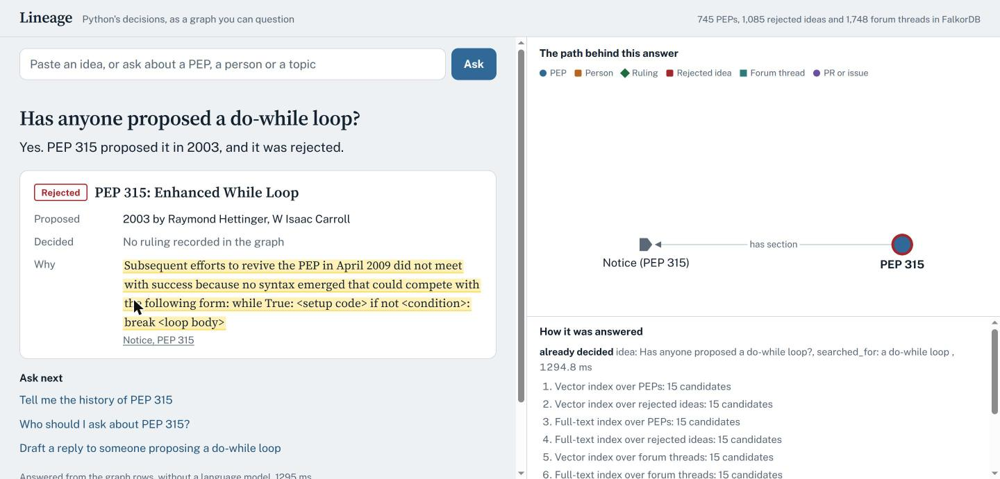
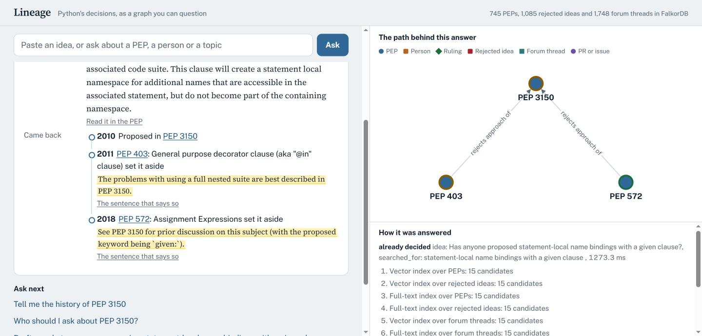
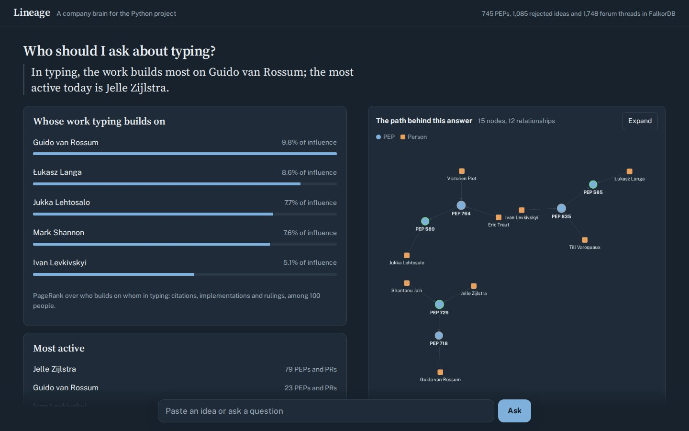

# Lineage

**Why does Python work the way it does?** Lineage is an agent that answers questions about the
Python language's decisions (who proposed what, who decided it, what it builds on, whether it's
still current, and who to ask) by walking a FalkorDB graph of PEPs, people, rulings and CPython
pull requests. Every answer comes with the graph path that produced it.

Built for **Graph Hacks: Context for AI Agents** (WeMakeDevs × FalkorDB), **Track 03: Company Brain**.
The "company" is the Python project, one of the largest open-source organisations, with 25 years of
decisions on public record.

> **Demo video:** [docs/video/lineage-demo.mp4](docs/video/lineage-demo.mp4) (2:26, captioned walkthrough of the running app) · [](https://codespaces.new/ANMOLGUPTA-24/lineage-agent?quickstart=1)
> (runs the app with the pre-built graph in your browser on GitHub's free Codespaces allowance; port 8000 opens by itself)

### Does the graph matter? Measured against vector search on the same data

| 98 questions with known answers | Lineage (graph) | Vector baseline* |
|---|---|---|
| Has this idea been decided? Right PEP as the top answer (**held-out** set) | **76%** | 53% |
| Who decided it? | **83%** | 17% |
| Did the idea come back later? | **100%** | 0% |
| How are two PEPs related? | **100%** | 25% |
| Is it still current? (31 superseded PEPs) | **100%** | 94% |

\*Same corpus, same embedding model, its no-match cutoff tuned on these very questions. Lineage is wrong on
3 of 32 confident matches; every miss is listed in [eval/RESULTS.md](eval/RESULTS.md). Details below.

**Scale:** 745 PEPs, 1,085 rejected ideas and 866 quotable sections parsed from the PEP sources, 1,748
discuss.python.org threads, 507 CPython PRs and 466 issues, 252 rulings, 2,175 people, built deterministically
from public data in under 4 minutes (`make ingest`), with a 47-test suite.

**What the graph does per answer:** typed traversals over evidence edges extracted from the PEPs' own text
(`REJECTS_APPROACH_OF`, `CITES`), `algo.SPpaths` with hub-aware weights, PageRank and WCC on per-area
projections, and session memory as graph nodes. Every answer lists the steps that ran, draws the subgraph it
walked, and shows the exact Cypher with its parameters.



| Did the idea come back? | Who should I ask about typing? |
|---|---|
|  |  |

## Why a graph?

The questions people actually ask about a language are about relationships:

- *Why does pattern matching look like this?* PEP 634 → PEP 622 (superseded) → … → earlier proposals it cites.
- *Is PEP 333 still the WSGI spec?* Follow `SUPERSEDES` to PEP 3333.
- *Who should I ask about typing?* Authors, deciders and implementers across 49 typing PEPs, ranked.
- *If one maintainer left packaging, what would be orphaned?*

Embedding search over PEP text can find a PEP, but it can't tell you that a PEP was superseded,
who ruled on it, or which earlier proposals it builds on four hops back. Those are edges.
**Take FalkorDB out and every tool stops working.** Vector search is only used to turn
"walrus operator" into PEP 572.

## What it does

| Tool | Question | Graph work |
|---|---|---|
| `resolve(text)` | "walrus operator" → PEP 572 | exact number → full-text index → vector index; reports when a match is ambiguous |
| `why(pep, depth≤4)` | Why/how did X come about? | variable-length `REQUIRES\|REFERENCES\|SUPERSEDES*1..4`, cheapest path per ancestor, drift filter by `vec.cosineDistance`; ruling + who made it; implementing PRs |
| `is_current(pep)` | Is X still how Python works? | `SUPERSEDES*` chain to the latest PEP |
| `who_knows(subject)` | Who should I ask? | **PageRank** over the area's own influence graph (`INFLUENCE_<area>`: who the area's PEPs and PRs build on), plus the most active people and, for a PEP, its own authors and decider |
| `bus_factor(subject)` | Where is knowledge concentrated? | PEPs that depend on one person, and **WCC** on the area's influence graph with and without its top person |
| `connection(a, b)` | How are A and B related? | **`algo.SPpaths`** weighted shortest paths over every relationship type |
| `already_decided(idea)` | Has Python already decided this? | vector + full-text candidates over PEPs, 1,085 rejected ideas and 1,748 forum threads, scored by a local cross-encoder; then a traversal: ruling, decider, the PEP's own rejection notice (quoted), `SUPERSEDES*`, and later PEPs that set the same approach aside (`REJECTS_APPROACH_OF`) |
| `draft_reply(idea)` | Answer a forum proposal | a reply built only from `already_decided` rows: quotes, deep links, who to ask. Nothing is posted |
| *(after every answer)* | "You asked about PEP 572 earlier…" | session memory in the graph: `(:Session)-[:ASKED]->(:Query)-[:ACCESSED]->(:PEP)`; `algo.SPpaths` from this answer's PEP to the nearest PEP asked about earlier; `my_session` answers "what did I ask earlier?". Carried across sync swaps |
| `recall` / `remember` | What did we find last time? | `Finding` nodes linked to the PEP they describe |

The model **never writes Cypher**. It picks a tool and fills typed arguments; each query is
hand-written and parameterized (no string concatenation, so no injection), and runs read-only.

### Four kinds of answer

1. **Answered with a path.** The graph holds the relationships, and the UI draws them.
2. **Answered from memory.** A dated finding from an earlier session.
3. **Not in the graph.** The entity exists but no relationship is recorded. Lineage says
   *"the graph doesn't record one"*, never *"there is none"*.
4. **Unknown entity.** The name doesn't resolve, so no query runs. ("Why does Python have the banana keyword?")

### Honesty guard

After the LLM writes its answer, every `PEP NNN` and person name it mentions is checked against the
tool results. If it mentions something the graph never returned, the answer is **rejected** and
replaced with one built directly from the rows. The UI shows the rejected text crossed out.
Decisions the source data doesn't attribute (pre-2018 rulings without a named delegate, for example)
are marked `inferred` and drawn dashed.

## Evaluation: does the graph matter?

98 questions with known answers: 49 "has Python already decided this idea?" (22 of them a **held-out**
set written after the system was built and never tuned on), 36 "is it current?" (generated from the
raw `peps.json`, not from the graph), plus who decided, did the idea come back, and how two PEPs relate.
The vector baseline gets the same corpus, the same embedding model, and a no-match cutoff tuned on these
very questions. With no LLM key in the loop it is scored on **evidence recall** (do its top 5 chunks
contain the answer?), an upper bound for any LLM answering from them.

| Question type | n | Lineage (tool rows) | Vector baseline | Baseline is credited when |
|---|---|---|---|---|
| Already decided? has a PEP · **held-out** | 17 | 13/17 (76%) | 9/17 (53%) | top-1 chunk is an expected PEP (cutoff applied) |
| Already decided? no PEP · **held-out** | 5 | 5/5 (100%) | 5/5 (100%) | top-1 similarity under the tuned cutoff |
| Already decided? has a PEP · dev (seen while building) | 20 | 16/20 (80%) | 14/20 (70%) | top-1 chunk is an expected PEP (cutoff applied) |
| Already decided? no PEP · dev | 7 | 6/7 (86%) | 7/7 (100%) | top-1 similarity under the tuned cutoff |
| Already decided? has a PEP · all (evidence in top 5) | 37 | 29/37 (78%) | 36/37 (97%) | an expected PEP anywhere in the top 5 |
| Is it current? (superseded) | 31 | 31/31 (100%) | 29/31 (94%) | top 5 include the latest PEP in the chain |
| Is it current? (controls) | 5 | 5/5 (100%) | n/a | (nothing to retrieve) |
| Who decided it? | 6 | 5/6 (83%) | 1/6 (17%) | decider named in the top 5 |
| Did the idea come back? | 3 | 3/3 (100%) | 0/3 (0%) | a later PEP citing it in the top 5 |
| How are A and B related? | 4 | 4/4 (100%) | 1/4 (25%) | a chunk of A naming B (or B naming A) in the top 5 |

- **Confidently wrong** (Lineage's top row is a "same idea" match on a PEP that did not propose it): 3/32 confident answers (ad24, ho04, ho06). `draft_reply` only quotes "same idea" matches, so this is the rate at which a draft would cite the wrong PEP.
- Baseline no-match cutoff (cosine similarity of the top chunk), tuned on these questions: **0.765**.
- Lineage answers that carry a graph path: 71/79 (90%) of correct answered items (the baseline returns text chunks, never paths, by construction).
- Keyword router (no LLM) picked the right tool: 98/98 (100%).
- Median latency: Lineage 515 ms, baseline 26 ms (warm, CPU, local FalkorDB).

**What this says.** Finding the PEP for an idea is a retrieval problem, and vectors are good at it:
the right PEP is in the baseline's top 5 for 97% of ideas. Lineage's cross-encoder picks it as the
*top* answer more often on held-out ideas (76% vs 53%) and never invents a match for ideas with no
PEP on held-out. But every question **after** finding the PEP is a relationship, and that is where
retrieval stops: who decided it (83% vs 17%), whether the idea came back (100% vs 0%), how two PEPs
relate (100% vs 25%). Those answers live on edges, not in any chunk.

**Where Lineage is wrong.** 3 of 32 confident "same idea" answers name the wrong PEP (HTTP/3 client →
PEP 476 on HTTPS verification; function decorators → PEP 647; dataclasses → PEP 681, dataclass
*transforms*). Several right answers are under-confident ("related"). Two ground-truth labels were
widened after the first run, both to PEPs that themselves proposed the idea (f-strings: 536, 701;
positional-only: 457); this is recorded in `eval/questions.jsonl`. Full list of misses:
[eval/RESULTS.md](eval/RESULTS.md). Reproduce: `uv run python -m eval.run`.

## Keeping it current

`make sync` (add `FETCH=1` to pull peps.json and the PEP sources first) rebuilds the graph **beside**
the live one, diffs the two and writes `(:Change {at, kind, detail})-[:CHANGED]->(:PEP)` for new PEPs,
status changes, new supersessions, new rulings and newly linked PRs. It then flips the
`lineage:active:<tenant>` alias with one `SET`. Agent memory (`Finding`) and earlier change history
are carried over; findings written during the rebuild are copied after the flip. It refuses to swap
a build that lost more than 5% of PEPs, a Redis lock stops two syncs running at once, and
`make rollback` points the alias back. The `changes` tool answers "what changed lately?".

Tested under load: 4 reader threads made 22,468 queries during a 2-minute sync, every one saw a
complete graph (745 PEPs, old or new), with 0 errors. A simulated upstream change (a status change,
a new PEP, a new supersession) came out as exactly those 3 `Change` events.

Why rebuild instead of patching: a long-lived graph that had been re-ingested in place many times
began returning a wrong endpoint for 3 edges on an unanchored scan (PEP 0 instead of PEP 831; the
anchored query was right), on FalkorDB 4.22.1. A fresh build was correct, and the sync diff is what
surfaced it.

## Graph model

```
(:Person {name, github, bridge})-[:AUTHORED {role}]->(:PEP {number, title, status, type, created,
                                                           python_version, url, abstract, rank,
                                                           community, embedding})
(:Person)-[:DELEGATE_FOR]->(:PEP)
(:PEP)-[:SUPERSEDES]->(:PEP)          from Superseded-By / Replaces headers
(:PEP)-[:REQUIRES]->(:PEP)            from Requires headers
(:PEP)-[:REFERENCES]->(:PEP)          PEP mentions in the body text
(:PEP)-[:RESOLVED_BY]->(:Decision {outcome, url, at, verdict, verdict_url})
(:Decision)-[:MADE_BY {inferred}]->(:Person | :Council)
(:PEP)-[:TARGETS]->(:Release {version})
(:PEP)-[:IN_TOPIC]->(:Topic {name})
(:PEP)-[:IN_COMMUNITY]->(:Community {name, hub, size})       label propagation
(:PR | :Issue {number, title, url, merged})-[:IMPLEMENTS | :DISCUSSES]->(:PEP)
(:Person)-[:OPENED]->(:PR | :Issue)
(:Finding {text, at, session})-[:ABOUT]->(:PEP)              agent memory
(:PEP)-[:HAS_SECTION]->(:Section {kind, title, text, url})   Motivation / Rationale / ruling notice
(:Alternative {title, text, url})-[:REJECTED_IN]->(:PEP)      each rejected idea, deep-linked
(:Alternative)-[:CITES {quote}]->(:PEP)                       the sentence that names another PEP
(:PEP)-[:REJECTS_APPROACH_OF {via}]->(:PEP)                   cited PEP was an older, never-adopted proposal
(:Person)-[:INFLUENCE_<area>{n}]->(:Person)                   per-area projection (ingest only)
(:Person)-[:EXPERT_IN {rank, share, items}]->(:Topic | :Community)
(:Thread {title, url, created, posts, text})-[:DISCUSSES | :MENTIONS]->(:PEP)   discuss.python.org
(:Person)-[:STARTED | :POSTED_IN {posts}]->(:Thread)          170 PEP authors matched by name
(:Change {at, kind, detail})-[:CHANGED]->(:PEP)               written by `make sync`
(:Session {id})-[:ASKED]->(:Query {text, at})-[:ACCESSED]->(:PEP)   per-session agent memory
```

Every edge has a `weight`. `REFERENCES` edges cost `1 + ln(1 + in-degree of target)`, so shortest
paths don't route through PEPs that everything cites. Steering Council edges cost 3 for the same reason.

**Algorithms used:** `algo.SPpaths` (connection), `algo.pageRank` (PEP rank, and per-area
expertise over each `INFLUENCE_<area>` projection), `algo.WCC` (bus factor: does the area split
without its top person?), `algo.betweenness` (person bridge score), `algo.labelPropagation`
(communities), plus full-text and vector indexes. FalkorDB's PageRank ignores parallel edges
(tested), so each projection has one edge per pair.

**Why a cross-encoder in `already_decided`:** vector distance alone could not separate "same idea"
from "same words" (multi-line lambdas landed 0.21 from conditional expressions, switch statements
0.30 from the switch PEP). Vectors and full-text only gather candidates; a local MiniLM
cross-encoder scores them: true matches scored 6.0-7.9 on hand-checked ideas, unrecorded ones
below 0. Above 5 is "same idea", 1-5 is labelled "related", and below that the answer is
"the graph doesn't record it", never "it's new". **Every query is listed in [docs/QUERIES.md](docs/QUERIES.md)**, generated
from what the tools actually run.

**Multi-tenant:** each tenant is its own FalkorDB graph (`select_graph`), not a filter clause.

## Data (all public)

| Source | What |
|---|---|
| [peps.python.org/api/peps.json](https://peps.python.org/api/peps.json) | 745 PEPs: status, authors, supersedes/requires, resolution links |
| [github.com/python/peps](https://github.com/python/peps) | PEP-Delegate / BDFL-Delegate, sponsors, abstracts, PEP-to-PEP mentions |
| [github.com/python/steering-council](https://github.com/python/steering-council) | Steering Council rulings on PEPs (closed issues and the final comment) |
| [github.com/python/cpython](https://github.com/python/cpython) | PRs and issues whose title names a PEP (backport bots filtered out) |
| [discuss.python.org](https://discuss.python.org/c/ideas/6) | 2,073 Ideas topics; first post and participants for the 1,551 with 5+ posts, plus the 197 PEP discussion threads (public JSON API, rate-limited, cached) |

Raw API responses are cached in `data/raw/*.json`, so building the graph needs no tokens.

## Run it

**Quickest (about a minute, graph pre-built):**

```bash
docker compose -f docker-compose.quick.yml up --build      # → http://localhost:8000
```

`deploy/graph.rdb` is a saved FalkorDB graph (5 MB) written by the same pinned FalkorDB image the
compose file uses, so nothing is ingested on startup. The **Codespaces** button above runs exactly this.

**Build the graph yourself from the cached public data (about 2 minutes on 8 cores):**

```bash
cp .env.example .env              # optional: add a free LLM key
docker compose up --build         # FalkorDB + ingest + app → http://localhost:8000
                                  # FalkorDB Browser → http://localhost:3000
```

Without Docker for the app:

```bash
docker run -d -p 6379:6379 -p 3000:3000 falkordb/falkordb:latest
uv sync && make ingest && make app
make test                         # behaviour tests against the loaded graph
make sync                         # rebuild beside the live graph and swap (see "Keeping it current")
uv run python -m eval.run         # the evaluation below
```

A single-container image (FalkorDB on localhost + the app, graph baked in) for any Docker host is in
`deploy/` (`sh deploy/bundle.sh`, then build `build/space`).

### LLM (optional, free options)

Any OpenAI-compatible endpoint works: a Gemini API key (free at aistudio.google.com), Groq, or a
local Ollama model. See `.env.example`. **With no key**, a keyword router picks the tools and the
answer is templated from the rows. The graph does the reasoning either way.

### MCP

The same tools are an MCP server, usable from Claude Desktop, Claude Code or Cursor:

```json
{"mcpServers": {"lineage": {"command": "uv", "args": ["run", "python", "-m", "lineage.mcp_server"],
                            "cwd": "/path/to/lineage"}}}
```

## Layout

```
lineage/ingest/peps.py     PEP API + rst parsing → graph
lineage/ingest/github.py   Steering Council + CPython (fetch → cache → load)
lineage/ingest/derive.py   reverse edges, weights, PageRank, CDLP, betweenness, indexes, embeddings
lineage/tools.py           the tool catalogue (all Cypher lives here)
lineage/agent.py           tool-calling loop, router fallback, guard
lineage/mcp_server.py      MCP server
lineage/server.py, web/    FastAPI + single-page UI (Cytoscape.js)
tests/                     outcomes, depth, supersession, tenant isolation, guard
```

## Limitations

- `REFERENCES` comes from text mentions, so "PEP 572 mentions PEP 3150" may mean "rejected the
  approach of", not "builds on". The UI labels these edges *references*, not *depends on*.
- Decision attribution without a named delegate is inferred from the date (BDFL before
  2018-07-12, Steering Council after) and flagged `inferred`.
- CPython PR links come from titles that name a PEP, which covers the main implementation
  PRs but not all of them.

## AI assistance disclosure

Built with Claude Code as a pair-programmer. The graph model, tool design, honesty rules and
data choices were decided by me, and I reviewed, ran and tested every query. Tuning values
(the drift threshold, edge weights) were checked by hand against known PEP histories.
